# AeroMart pipeline architecture

This is the architecture implemented by the repository scripts, checked against the milestone brief in [CASE_STUDY.md](./CASE_STUDY.md). It documents the current pipeline, not the intended future vector-search system.

## Pipeline diagram

```mermaid
flowchart LR
    DS["Amazon Reviews 2023<br/>reviews + product metadata"] -->|"manual file copy"| BR["Bronze files<br/>data/bronze/review/*.jsonl.gz<br/>data/bronze/metadata/*.jsonl.gz"]
    BR -->|"ingestion.py<br/>Spark local[*]"| ING["Select fields, fill null price<br/>filter null review text<br/>deduplicate metadata key<br/>inner join on parent_asin"]
    ING --> SIL["Silver Parquet<br/>data/silver/complete_reviews"]
    SIL -->|"transformation.py<br/>Spark local[*]"| TRANS["Build product/user dimensions<br/>chunk review text<br/>60 words, 10-word overlap"]
    TRANS --> PROD["Gold Parquet<br/>data/gold/dim_products"]
    TRANS --> USER["Gold Parquet<br/>data/gold/dim_users"]
    TRANS --> FACT["Gold Parquet<br/>data/gold/fact_vectors"]
    FACT -->|"load_gold.py<br/>SentenceTransformer<br/>all-MiniLM-L6-v2"| EMB["Generate one embedding per chunk"]
    EMB --> FINAL["Parquet with embedding array<br/>data/gold/final_vector_storage"]
    FINAL -.->|"not implemented"| VDB["Vector database / index"]
    VDB -.->|"not implemented"| SEARCH["Semantic search service"]

    classDef existing fill:#eef4ff,stroke:#5275a5,color:#14243c;
    classDef terminal fill:#fff1e6,stroke:#ed7d31,color:#40240f;
    classDef missing fill:#fff,stroke:#8b9bb4,stroke-dasharray: 5 5,color:#52627a;
    class DS,BR,ING,SIL,TRANS,PROD,USER,FACT,EMB existing;
    class FINAL terminal;
    class VDB,SEARCH missing;
```

The repository also has a case-study overview graphic at [IMAGES/aeromart-architecture.png](./IMAGES/aeromart-architecture.png). The diagram above adds script-level transformations and outputs from the current code. Dotted boxes are future components, not implemented destinations.

## Stage-by-stage map

Execution order is inferred from the scripts' input/output paths. There is no scheduler or orchestration code shown. The paths below are relative to the current working directory; run commands from the repository root to make them resolve as intended. The scripts configure Spark with `local[*]`, so this code runs on one machine rather than a distributed on-prem cluster.

| Stage | Script | Input | Work performed | Output |
|---|---|---|---|---|
| Raw landing | External/manual | Amazon Reviews 2023 review and metadata files | The case study says files are manually copied unchanged into Bronze. | `data/bronze/review/*.jsonl.gz` and `data/bronze/metadata/*.jsonl.gz` |
| Silver | [ingestion.py](./ingestion.py) | The two Bronze globs | Read JSON, project selected fields, replace missing metadata price with `0.0`, deduplicate metadata by product key, remove reviews with null text, inner join on `parent_asin`. | `data/silver/complete_reviews` (Parquet, overwrite) |
| Gold dimensions and chunks | [transformation.py](./transformation.py) | `./data/silver/complete_reviews` (Parquet) | Create product and user aggregates; run a Python UDF to split review text into overlapping word chunks. | `./data/gold/dim_products`, `data/gold/dim_users`, and `data/gold/fact_vectors` (Parquet, overwrite) |
| Embedding | [load_gold.py](./load_gold.py) | `data/gold/fact_vectors` (Parquet) and the `all-MiniLM-L6-v2` model | Encode each `review_chunk`; append an embedding array. | `data/gold/final_vector_storage` (Parquet, overwrite) |
| Index/search | Not present | Would consume embedding output | No database client, vector index, or search service is implemented in these scripts. | None |

### Column lineage

Column names below describe the code's selected/produced output, not a claim that every source record contains valid values. JSON is read without an explicit schema in `ingestion.py`.

| Boundary/table | Columns and transformations |
|---|---|
| Metadata input to `meta_clean` | Select `parent_asin` as `metadata_parent_asin`, plus `title`, `main_category`, and `price`. Replace null `price` with `0.0`. Keep one unspecified row per `metadata_parent_asin` using `drop_duplicates`; no deterministic winner is defined. Other metadata fields are not selected. |
| Review input to `review_clean` | Select `parent_asin`, `user_id`, `rating`, `text`, and `timestamp`; filter out rows where `text IS NULL`. Other review fields are not selected (the brief specifically notes review `title`, `verified_purchase`, and `helpful_vote` among fields omitted). Empty strings and whitespace-only text are not filtered here. |
| Silver `complete_reviews` | Inner join the selected reviews to metadata on review `parent_asin` = `metadata_parent_asin`; drop the temporary `metadata_parent_asin` join column. Output columns: `parent_asin`, `user_id`, `rating`, `text`, `timestamp`, `title`, `main_category`, `price`. Unmatched reviews do not reach this output. |
| Gold `dim_products` | Select silver `parent_asin` as `product_id`, `title` as `product_name`, and retain `main_category`, `price`; apply `distinct()` to the full selected row. Output: `product_id`, `product_name`, `main_category`, `price`. This does not guarantee one row per `product_id` when selected metadata differs. |
| Gold `dim_users` | Group silver rows by `user_id`; create `review_count` as `count(*)` and `avg_rating_given` as `avg(rating)`. Output: `user_id`, `review_count`, `avg_rating_given`. |
| Gold `fact_vectors` | Apply chunk UDF to silver `text`, `explode` the resulting array, select silver `parent_asin` as `product_id`, plus `user_id`, `rating`, and generated `review_chunk`. Output: `product_id`, `user_id`, `rating`, `review_chunk`. The original `text`, `timestamp`, and product metadata are not carried into this table. Reviews that produce no chunks produce no fact rows after `explode`. |
| Gold `final_vector_storage` | Read all `fact_vectors` columns unchanged and append `embedding`, an `ArrayType(FloatType())` returned by `get_embedding`. Intended shape for the named model is a 384-value vector, but this code does not validate the dimension or vector values. Output columns: `product_id`, `user_id`, `rating`, `review_chunk`, `embedding`. |

### Active versus commented-out chunker

In [transformation.py](./transformation.py), the commented-out implementation at lines 20–43 chunks by a maximum of about 400 **characters**, carries a 50-character overlap, and tries separator boundaries such as paragraph breaks, newlines, sentence punctuation, and spaces. The active function at lines 45–69 instead splits on whitespace and takes windows of up to 60 **words**, advancing by 50 words (a 10-word overlap); it does not use sentence/paragraph boundaries. Despite the function name `recursive_chunker`, neither implementation recursively calls itself.

Both versions catch all exceptions and return an empty list, which can hide bad inputs or implementation errors as dropped chunks. The active version is what `chunk_udf` registers and what `fact_vectors` uses; the commented version has no runtime effect. This is a behavior change in chunk sizing and boundary selection, not merely a refactoring, so chunk counts and retrieval quality should be measured before choosing between them. Also, because the commented separator list includes an empty-string fallback, separator behavior at that fallback should be checked if that older implementation is ever reactivated.

## Operational boundary and limitations

- Writes use Parquet paths on local storage, not a relational database or vector database. `final_vector_storage` is therefore an embedding file store, not a searchable index.
- Data is overwritten at each output path. The scripts do not show staged publication, rollback, retries, or orchestration.
- The Bronze files are external/manual inputs. The current repository listing does not include those input files, so their row counts and schemas have not been inspected here.
- `load_gold.py` references a model by name. The code does not document an offline model artifact location or guarantee that an on-prem server can download it.
- The architecture describes code behavior and path-level dependencies; the pipeline was not executed as part of this milestone review.

## Milestone progress against `CASE_STUDY.md`

| Milestone | Status in this review | Evidence / remaining work |
|---|---|---|
| 1. Map the pipeline | **Complete for the map deliverables.** | This document provides a code-checked architecture, and the README has script-by-script inputs, outputs, and column lineage. The prompt log records the explanation and evidence check. |
| 2. Audit the code | **Complete for the checklist report.** | [AUDIT_REPORT.md](./AUDIT_REPORT.md) records all 46 checklist IDs A-1 through F-4 with status, code evidence, severity, and AeroMart impact; it opens with a prioritized top five. The review is static and does not measure production behavior. |
| 3. Propose improvements | **Not complete.** | No code changes for the top five findings or finding-linked commits are part of this milestone review. |
| 4. Plan for data quality | **Not complete against the milestone's Done-when check.** | A general plan exists in the README, but a complete check-by-check `DATA_QUALITY.md` with layer, rule, failure handling, and coverage of every section C finding is still needed. |
| 5. Document everything | **Not complete.** | The README still contains the original student notice and is not a full setup/run/limitations guide; no `DATA_DICTIONARY.md`, complete function docstrings, or Copilot reflection is present. |

Milestones 3–5 remain outstanding; Milestones 1 and 2 have their map and checklist-audit deliverables in this repository. Completion criteria for all milestones are specified in [CASE_STUDY.md](./CASE_STUDY.md).
